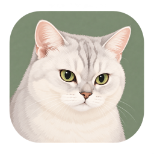

<div align="center">


# 飘伴 PiaoPal

以家里的猫咪飘飘为灵感，为 Mac 带来一位像素伙伴。

**macOS 13+ · Apple Silicon / Intel · 0.2.0**

[下载](https://github.com/Sherwin-NG/PiaoPal/releases/latest) · [反馈问题](https://github.com/Sherwin-NG/PiaoPal/issues) · [构建说明](docs/development.md) · [许可与致谢](THIRD_PARTY_NOTICES.md)
</div>

PiaoPal 是 [Sherwin-NG](https://github.com/Sherwin-NG) 独立维护的桌面宠物项目。银白色猫咪飘飘来自真实宠物照片：图标采用温柔插画，桌面角色采用像素动画。本项目使用独立仓库、应用标识、数据目录和更新地址，从 **0.0.1** 开始发布。

首版专注 Mac。六款宠物继续保留，并使用新的伙伴名称：**飘飘 PiaoPiao、团团 TuanTuan、豆豆 Dodo、斑斑 BanBan、桃桃 TaoTao、暮暮 MuMu**。部分底层实现与既有素材按原开源许可使用，完整来源见[第三方说明](THIRD_PARTY_NOTICES.md)。

**0.2.0** 修复异常坐标导致宠物卡住、屏幕缩小后休眠或停靠宠物留在屏幕外的问题，改进显示恢复，并增加本地启动与退出诊断。默认大小保持 **1 倍**，已有自定义大小与相伴记录继续保留。历史偶发自行退出的原因尚未确证，详情见[本版说明](releases/v0.2.0.md)。

## 下载和使用

打开 [GitHub Releases](https://github.com/Sherwin-NG/PiaoPal/releases/latest)，在 **Assets** 中选择：

| 文件 | 用途 |
| --- | --- |
| `PiaoPal-v0.2.0-macOS-universal.dmg` | 推荐。打开后把 PiaoPal 拖入 Applications |
| `PiaoPal-v0.2.0-macOS-universal.zip` | 解压后把 PiaoPal.app 放入 Applications |
| `SHA256SUMS.txt` | 核对下载文件完整性 |

同一个安装包支持 Apple Silicon 和 Intel，系统要求 macOS 13 或更新。GitHub 自动附带的 **Source code** 是源码，不是安装包。

打开应用后，从菜单栏爪印进入设置；也可以再次打开 PiaoPal，将设置窗口带到前面。应用不会常驻 Dock。可以选择伙伴、调整大小和速度，或让她休息。设置和相伴记录保存在本机，首版不提供云同步。

当前社区发行包使用 **ad-hoc 签名，未进行 Apple Developer ID 签名和公证**。首次打开时，macOS 可能提示无法验证开发者。核实下载来源后，可参考 [Apple 的打开说明](https://support.apple.com/102445)；无需关闭系统安全功能。

## 可以做什么

- 跟随鼠标活动，播放八方向行走、坐下、发呆、挠痒和睡眠动画。
- 六款内置伙伴，自定义昵称、大小和移动速度。
- 菜单栏休息与唤醒、激光逗猫、点击穿透和多屏活动。
- 查看统计、等级、连续相伴天数和 32 项成就。
- 导出陪伴卡，查看六页相伴回顾。
- 从宠物目录查看可用角色，在设置中检查 PiaoPal 更新。

这是独立应用：设置使用 `io.github.sherwinng.PiaoPal`，自定义素材存放于 `~/Library/Application Support/PiaoPal/Sprites/`。它不读取或覆盖其他应用的数据，也不自动迁移早期试制版本的记录。退出早期试制应用后再运行本版，可避免多个桌宠同时出现。

## 语言

支持 **简体中文、繁體中文、English、Français、日本語、Deutsch、Español**。首次启动按系统语言选择，也可在应用内切换。简体与繁体中文覆盖引导、设置、卡片、回顾、成就和错误提示。

简体显示名称为「飘伴」，繁体为「飄伴」，英文为「PiaoPal」。原始文案位于 `App/Localization/Language.swift`，成就文案位于 `App/Achievements/Achievement.swift`。

## 开发

需要 macOS、Xcode 和命令行工具。项目已提交 Xcode 工程，无需额外依赖即可打开：

```sh
git clone https://github.com/Sherwin-NG/PiaoPal.git
cd PiaoPal
open PiaoPal.xcodeproj
```

选择 `PiaoPal` scheme。脚本可以执行针对性检查并生成双架构发行包：

```sh
bash scripts/test-macos.sh
bash scripts/package-macos.sh 0.2.0
```

输出位于 `dist/`。打包流程构建 arm64 + x86_64、校验应用签名和 DMG，并生成 SHA-256 文件。它使用运行时 Metal 着色器编译路径，仍由 Metal 渲染；不要求额外安装独立 Metal Toolchain。

修改 `project.yml` 后，使用 [XcodeGen](https://github.com/yonaskolb/XcodeGen) 运行 `xcodegen generate`。素材生成、预览和目录结构见[开发说明](docs/development.md)，发版流程见[维护者说明](docs/releasing.md)。自动化检查不能替代每种硬件和多屏组合的实际体验验证。

## 开源与素材来源

- 项目维护、中文体验和飘飘视觉方向：Sherwin-NG。
- 飘飘图标和像素角色：根据所有者提供的真实宠物照片，以 AI 辅助制作；原照片不随仓库或应用发布。
- 部分 macOS 实现：hellov3an / v3an，来自 OnekoMac，MIT License。
- 原有五款精灵：kyrie25/spicetify-oneko，沿用 adryd 的开源项目与署名，MIT License。
- 历史项目致谢：Masayuki Koba 的 oneko（1989）。

完整版权与许可见 [LICENSE](LICENSE) 和 [THIRD_PARTY_NOTICES.md](THIRD_PARTY_NOTICES.md)，也包含在应用与 DMG 中。PiaoPal 使用独立品牌，并保留所使用开源代码和素材的原作者权利。
